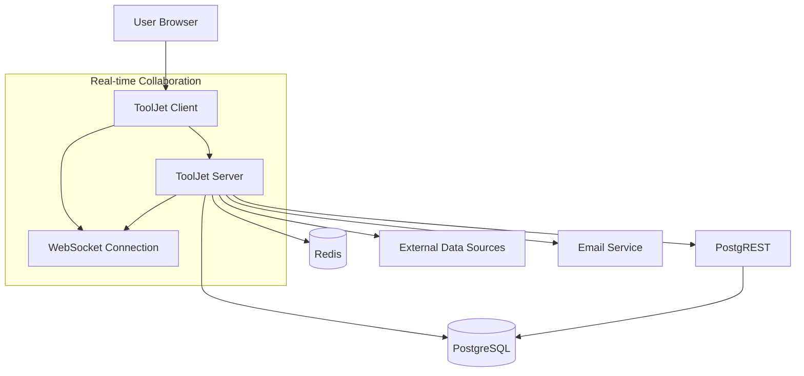

# ToolJet Architecture Overview

## System Overview

ToolJet is an open-source low-code framework designed to build and deploy internal tools with minimal engineering effort. The system consists of two main components: **ToolJet Server** and **ToolJet Client**.

## Architecture Components

### 1. ToolJet Server (Backend)

**Technology Stack:**
- **Framework**: NestJS (Node.js)
- **Language**: TypeScript
- **Database**: PostgreSQL
- **ORM**: TypeORM
- **Authentication**: JWT with Passport
- **Real-time**: WebSockets
- **Background Jobs**: Bull Queue with Redis

**Key Responsibilities:**
- Authentication and authorization
- Application definition persistence
- Query execution and data source management
- User and organization management
- Plugin system management
- Real-time collaboration features

**Core Modules:**
- **Authentication Module**: JWT-based auth with SSO support
- **Apps Module**: Application lifecycle management
- **Data Sources Module**: External service integrations
- **Users Module**: User and organization management
- **Plugins Module**: Extensible plugin architecture
- **WebSocket Module**: Real-time collaboration

### 2. ToolJet Client (Frontend)

**Technology Stack:**
- **Framework**: React 18
- **Language**: JavaScript/JSX
- **State Management**: Zustand
- **UI Components**: Custom component library
- **Build Tool**: Webpack
- **Styling**: SCSS + Tailwind CSS

**Key Features:**
- Visual drag-and-drop app builder
- 45+ built-in responsive components
- Real-time collaborative editing
- Multi-page application support
- Custom JavaScript/Python code execution

### 3. Database Layer

**Primary Database**: PostgreSQL
- **Purpose**: Application data, user management, app definitions
- **ORM**: TypeORM with migrations
- **Key Entities**: Users, Organizations, Apps, DataSources, Queries

**PostgREST Integration**:
- **Purpose**: RESTful API for ToolJet Database (built-in database)
- **Functionality**: Automatic API generation from PostgreSQL schema

### 4. External Dependencies

**Required Services:**
- **PostgreSQL**: Primary data storage
- **Redis**: Session storage and job queues
- **Email Service**: SMTP/SendGrid/Mailgun for notifications

**Optional Services:**
- **PostgREST**: For ToolJet Database functionality
- **Object Storage**: S3/GCS/Minio for file storage

## Data Flow Architecture

## Security Architecture

**Authentication & Authorization:**
- JWT-based authentication
- Role-based access control (RBAC)
- Organization-level permissions
- App-level permissions
- Granular component-level permissions

**Data Security:**
- AES-256-GCM encryption for credentials
- Secure credential storage
- Data privacy (ToolJet acts as proxy only)
- SSO integration support

## Deployment Architecture

**Supported Deployment Options:**
- **Docker**: Single container deployment
- **Kubernetes**: Production-ready orchestration
- **Cloud Platforms**: AWS EC2, GCP, Azure
- **Self-hosted**: Various infrastructure options

**Scalability Considerations:**
- Horizontal scaling via Kubernetes
- Stateless server design
- Database connection pooling
- Redis for session management
- Background job processing

## Plugin Architecture

**Extensibility:**
- Command-line tool for plugin creation
- Plugin marketplace integration
- Custom data source connectors
- JavaScript/Python code execution
- Isolated execution environment

## Performance Considerations

**Frontend Optimization:**
- Code splitting and lazy loading
- Component virtualization
- Optimized bundle sizes
- CDN integration

**Backend Optimization:**
- Database query optimization
- Caching strategies
- Connection pooling
- Background job processing
- Real-time collaboration optimization

## Monitoring & Observability

**Logging:**
- Structured logging with Winston
- Request/response logging
- Error tracking with Sentry

**Metrics:**
- OpenTelemetry integration
- Performance monitoring
- Health check endpoints

## Development Workflow

**Local Development:**
- Docker Compose for local setup
- Hot reloading for both client and server
- Database migrations
- Plugin development environment

**Testing:**
- Jest for unit testing
- Cypress for E2E testing
- Polly for API mocking
- Test coverage reporting

## Future Architecture Considerations

**Planned Enhancements:**
- Microservices migration path
- Enhanced plugin system
- Advanced caching strategies
- Multi-tenant architecture improvements
- Enhanced real-time collaboration features
