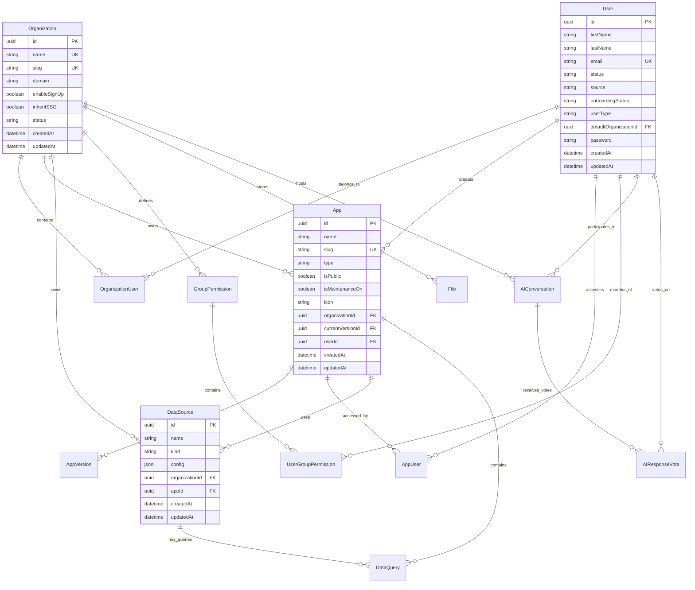

# ToolJet Data Model

## Overview

ToolJet uses PostgreSQL as its primary database with TypeORM as the Object-Relational Mapping (ORM) layer. The data model supports multi-tenant architecture with organizations, users, applications, and various integrations.

## Core Entities

### User Management

#### Users
The central user entity representing all users in the system.

**Key Fields:**
- `id`: UUID primary key
- `firstName`, `lastName`: User's name
- `email`: Unique email address
- `status`: User status (invited, verified, active, archived)
- `source`: Registration source (signup, invite, google, git, ldap, saml)
- `onboardingStatus`: Onboarding progress tracking
- `userType`: Instance or workspace user
- `defaultOrganizationId`: Primary organization reference

#### Organizations
Multi-tenant workspace management.

**Key Fields:**
- `id`: UUID primary key
- `name`: Organization name (unique)
- `slug`: URL-friendly identifier
- `domain`: Organization domain
- `enableSignUp`: Allow public signups
- `inheritSSO`: SSO inheritance settings
- `status`: Active or archived

#### Organization Users
Junction table linking users to organizations with roles.

**Key Fields:**
- `userId`: Reference to User
- `organizationId`: Reference to Organization
- `role`: User role within organization
- `status`: Membership status

### Application Management

#### Apps
Core application entity representing ToolJet applications.

**Key Fields:**
- `id`: UUID primary key
- `name`: Application name
- `slug`: URL-friendly identifier
- `type`: Application type (frontend, backend, etc.)
- `isPublic`: Public visibility flag
- `isMaintenanceOn`: Maintenance mode flag
- `icon`: Application icon
- `organizationId`: Owning organization
- `currentVersionId`: Active version reference
- `userId`: Creator user reference

#### App Versions
Version control for applications.

**Key Fields:**
- `id`: UUID primary key
- `appId`: Reference to App
- `versionFromId`: Previous version reference
- `name`: Version name
- `definition`: Application definition (JSON)
- `isCurrentVersion`: Active version flag

#### App Users
User access control for applications.

**Key Fields:**
- `appId`: Reference to App
- `userId`: Reference to User
- `role`: User role within app

### Data Integration

#### Data Sources
External service integrations.

**Key Fields:**
- `id`: UUID primary key
- `name`: Data source name
- `kind`: Data source type (postgres, mysql, restapi, etc.)
- `config`: Encrypted configuration
- `organizationId`: Owning organization
- `appId`: Associated application

#### Data Queries
Query definitions for data sources.

**Key Fields:**
- `id`: UUID primary key
- `name`: Query name
- `dataSourceId`: Reference to DataSource
- `appId`: Associated application
- `query`: Query definition (JSON)
- `kind`: Query type

### Permission System

#### Group Permissions
Role-based access control groups.

**Key Fields:**
- `id`: UUID primary key
- `name`: Group name
- `organizationId`: Owning organization
- `permissions`: Permission definitions (JSON)

#### User Group Permissions
User membership in permission groups.

**Key Fields:**
- `userId`: Reference to User
- `groupId`: Reference to GroupPermission
- `role`: Role within group

### File Management

#### Files
File storage and management.

**Key Fields:**
- `id`: UUID primary key
- `name`: File name
- `mimetype`: MIME type
- `size`: File size
- `data`: File data (binary)
- `organizationId`: Owning organization

### AI Features

#### AI Conversations
AI chat conversation history.

**Key Fields:**
- `id`: UUID primary key
- `userId`: Reference to User
- `organizationId`: Owning organization
- `messages`: Conversation messages (JSON)
- `context`: Conversation context

#### AI Response Votes
User feedback on AI responses.

**Key Fields:**
- `id`: UUID primary key
- `conversationId`: Reference to AIConversation
- `userId`: Reference to User
- `vote`: Vote value (up/down)

## Entity Relationship Diagram

## Database Design Principles

### Security
- **Encryption**: Sensitive data (passwords, API keys) encrypted with AES-256-GCM
- **Access Control**: Multi-level permissions (organization, app, component)
- **Audit Trail**: Comprehensive logging of data access and modifications

### Performance
- **Indexing**: Strategic indexes on frequently queried fields
- **Connection Pooling**: Efficient database connection management
- **Query Optimization**: TypeORM query optimization and caching

### Scalability
- **Multi-tenancy**: Organization-based data isolation
- **Versioning**: Application version control for rollback capabilities
- **Modular Design**: Extensible schema for new features

## Migration Strategy

### Database Migrations
- **TypeORM Migrations**: Automated schema changes
- **Data Migrations**: Separate data transformation scripts
- **Rollback Support**: Reversible migration scripts

### Schema Evolution
- **Backward Compatibility**: Maintain API compatibility during changes
- **Gradual Migration**: Phased rollout of schema changes
- **Data Validation**: Ensure data integrity during migrations

## Data Access Patterns

### Read Operations
- **Eager Loading**: Load related entities efficiently
- **Pagination**: Handle large datasets with cursor-based pagination
- **Caching**: Redis caching for frequently accessed data

### Write Operations
- **Transactions**: Ensure data consistency with database transactions
- **Validation**: Input validation at both application and database levels
- **Audit Logging**: Track all data modifications

## Backup and Recovery

### Backup Strategy
- **Regular Backups**: Automated daily backups
- **Point-in-Time Recovery**: Transaction log backups
- **Cross-Region Replication**: Geographic redundancy

### Recovery Procedures
- **Disaster Recovery**: Documented recovery procedures
- **Data Validation**: Post-recovery data integrity checks
- **Service Restoration**: Application service recovery steps

## Monitoring and Observability

### Database Metrics
- **Performance Monitoring**: Query performance tracking
- **Connection Monitoring**: Database connection health
- **Storage Monitoring**: Disk usage and growth tracking

### Data Quality
- **Data Validation**: Automated data quality checks
- **Anomaly Detection**: Unusual data pattern detection
- **Data Lineage**: Track data flow and transformations

## Future Considerations

### Scalability Enhancements
- **Read Replicas**: Separate read and write databases
- **Sharding**: Horizontal database partitioning
- **Caching Layer**: Advanced caching strategies

### Data Governance
- **Data Classification**: Sensitive data identification
- **Retention Policies**: Automated data lifecycle management
- **Compliance**: GDPR and other regulatory compliance features
